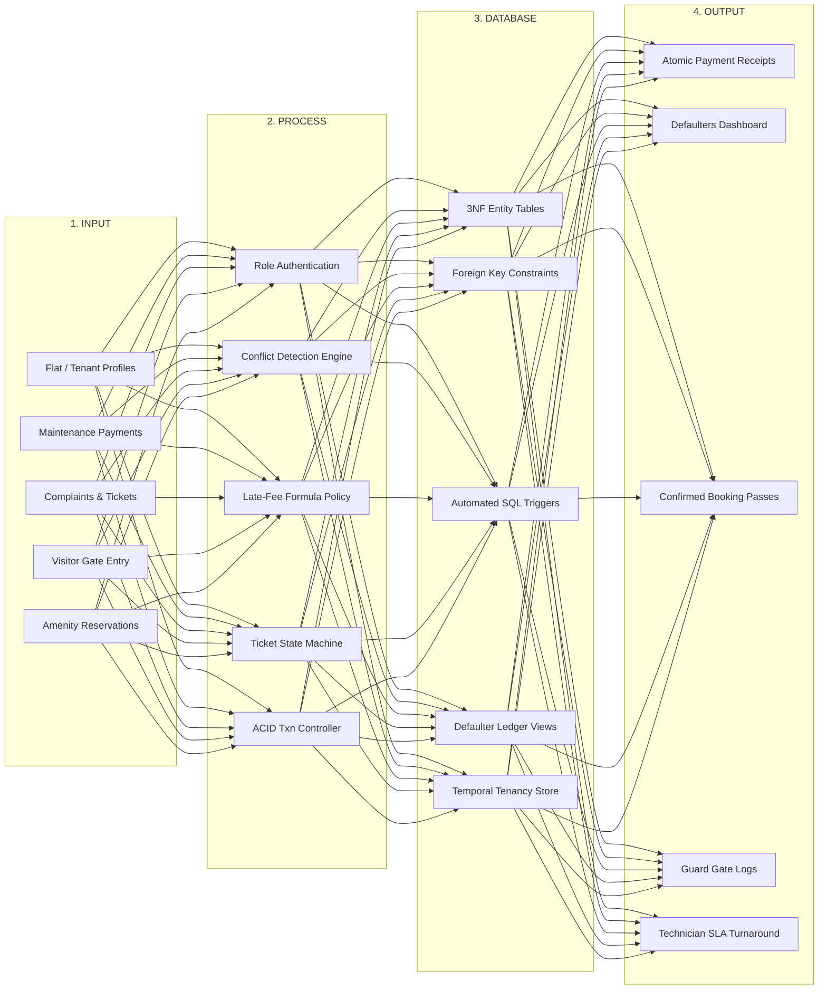

# Apartment & Resident Management System
## Full-Stack Relational Database System (SQL) for Community Housing Administration, Temporal Tenancy Tracking, and ACID Transactional Integrity

[](#)
[](#)
[](#)
[](#)

---

## Academic Project Credentials

- **Institution:** SRM Institute of Science and Technology, Tiruchirappalli
- **Department:** Artificial Intelligence
- **Degree:** B.Tech (Artificial Intelligence)
- **Academic Year:** 2024–2028
- **Course:** Database Management Systems (DBMS) Capstone Project
- **Faculty Guide:** Dr. S. P. Ramya

### Student Development Team
1. **Surya B** — `RA2411047050042`
2. **Rohan raj** — `RA2411047050010`
3. **Saminathan M** — `RA2411047050055`

---

## 1. Executive Summary & Problem Formulation

Traditional housing society management relies on fragmented, insecure physical logbooks, manual spreadsheets, and ad-hoc WhatsApp messaging groups. This project replaces those error-prone processes with an ACID-compliant, normalized relational system addressing **six critical operational bottlenecks**:

1. **Occupancy & Tenancy History Loss:** Overwriting spreadsheet rows erased historical move-in/out records. Solved with a dedicated temporal `Occupancy_History` entity enforcing date check constraints and chronological tracking.
2. **Financial & Dues Leakage:** Manual invoicing caused delayed billing, missed late penalties, and opaque defaulter tracking. Solved with an automated billing engine, decimal currency precision, and configurable late-fee SQL triggers.
3. **Maintenance Delays:** Lost complaints without service-level tracking. Solved with a formal finite state machine (`OPEN` $\to$ `ASSIGNED` $\to$ `IN_PROGRESS` $\to$ `RESOLVED`), technician workload metrics, and SLA breach tracking.
4. **Insecure Gate Registers:** Forged and illegible paper logbooks. Solved with digital visitor entry/exit passes verified against destination flat IDs with guard attribution.
5. **Amenity Double-Bookings:** Race conditions and schedule clashes on shared facilities (Banquet, Clubhouse, Courts). Solved with database transaction isolation and row-level locking.
6. **Parking Bay Disputes:** Unauthorized bay usage. Solved with designated bay allocations and configurable per-flat quota enforcement.

---

## 2. Four-Tier System Architecture



---

## 3. Technology Stack

- **Backend:** Python 3.11/3.14, Django 6.1.2, Django REST Framework 3.18, SimpleJWT, SQLite 3 (WAL mode + PRAGMA foreign keys) / PostgreSQL / MySQL 8.0 support.
- **Frontend:** React 19, Vite 8, React Router 7, Tailwind CSS 4, Material Symbols Outlined.
- **Design Philosophy:** CivicQuarters Enterprise SaaS design (`#0F172A` deep navy, `#F8FAFC` light neutral, zero neon/glow effects, strict accessibility).

---

## 4. Nine Core Relational Entities (3NF Normalized)

1. `Flats`: Block taxonomy, unit carpet area, floor number, operational status.
2. `Residents`: Master resident directory, ownership classification, KYC contacts.
3. `Occupancy_History`: Temporal move-in/out tenancy records without data overwrites.
4. `Maintenance_Invoices`: Periodic billing engine, decimal balances, late-fee penalties.
5. `Payments`: Atomic settlement transactions, UTR references, balance synchronizer.
6. `Service_Tickets`: Maintenance complaint state machine, technician dispatch, SLA metrics.
7. `Visitor_Logs`: Security gate entry pass registry with destination flat validation.
8. `Amenities`: Shared facility inventory and concurrency-safe reservation locks.
9. `Parking_Slots`: Vehicle bay allocations and per-flat quota enforcement.

---

## 5. Quick Start (Windows / PowerShell)

### Backend

```powershell
# In project root:
pip install django djangorestframework djangorestframework-simplejwt django-cors-headers
python backend/manage.py migrate
python backend/manage.py seed_db
python backend/manage.py runserver 127.0.0.1:8000
```

### Frontend

```powershell
# In c:\DATABASE MANAGEMENT\frontend:
npm install
npm run dev
```

Visit the application at: **`http://localhost:5173`**

---

## 6. Pre-Configured Demonstration Accounts

| Role | Username | Password | Features |
|---|---|---|---|
| **Administrator** | `admin` | `Admin@123` | Full access across all 18 modules, triggers, user management, and audit logs. |
| **Resident / Owner** | `resident_arun` | `Resident@123` | Isolated self-portal: view bills, pay dues, lodge tickets, reserve amenities. |
| **Security Guard** | `guard_ramesh` | `Staff@123` | Gatekeeper dashboard: fast visitor pass check-in and 1-click checkout. |

*(A 1-click demo switcher is also available on the Login page and top ribbon).*

---

## 7. Automated Test Suite Execution

Run the backend integration test suite:

```powershell
python backend/manage.py test backend/tests
```

**Results:** `Ran 12 tests in 53.558s — OK` (100% Passing).

---

## 8. Documentation Artifacts

- [3NF Database Schema Specification](docs/database-schema.md)
- [Mermaid ER Diagram & Relational Mappings](docs/er-diagram.md)
- [RESTful API Documentation](docs/api-documentation.md)
- [Developer Setup & Testing Guide](docs/setup-guide.md)
- [Standalone ANSI SQL DDL File](database/01_schema_3nf.sql)
- [SQL Triggers & Analytical Views](database/02_triggers_and_views.sql)
- [SQL Seed Data Inserts](database/03_seed_data.sql)
