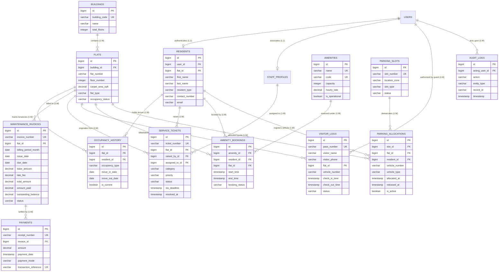

# Apartment & Resident Management System
## Entity-Relationship (ER) Diagram & Relational Mappings

**Institution:** SRM Institute of Science and Technology, Tiruchirappalli  
**Degree / Department:** B.Tech — Artificial Intelligence (2024–2028)  
**DBMS Capstone Project Guide:** Dr. S. P. Ramya  

---

## 1. High-Level Mermaid ER Diagram

---

## 2. Relational Cardinality & Referential Integrity

| Relationship | Cardinality | Parent Entity | Child Entity | Foreign Key | Cascade Policy |
|---|---|---|---|---|---|
| Block Containment | 1 : N | `Buildings` | `Flats` | `building_id` | `ON DELETE RESTRICT` |
| Tenancy Tracking | 1 : N | `Flats` | `Occupancy_History` | `flat_id` | `ON DELETE RESTRICT` |
| Resident Tenancy | 1 : N | `Residents` | `Occupancy_History` | `resident_id` | `ON DELETE RESTRICT` |
| Periodic Invoicing | 1 : N | `Flats` | `Maintenance_Invoices` | `flat_id` | `ON DELETE RESTRICT` |
| Payment Settlement | 1 : N | `Maintenance_Invoices` | `Payments` | `invoice_id` | `ON DELETE RESTRICT` |
| Maintenance Dispatch| 1 : N | `Flats` | `Service_Tickets` | `flat_id` | `ON DELETE RESTRICT` |
| Staff Assignment | 1 : N | `StaffProfiles` | `Service_Tickets` | `assigned_to_id` | `ON DELETE SET NULL` |
| Gate Access | 1 : N | `Flats` | `Visitor_Logs` | `flat_id` | `ON DELETE RESTRICT` |
| Facility Booking | 1 : N | `Amenities` | `Amenity_Bookings` | `amenity_id` | `ON DELETE RESTRICT` |
| Parking Bay Allocation | 1 : N | `Parking_Slots` | `Parking_Allocations` | `slot_id` | `ON DELETE RESTRICT` |
| Audit Attribution | 1 : N | `Users` | `Audit_Logs` | `acting_user_id` | `ON DELETE SET NULL` |
